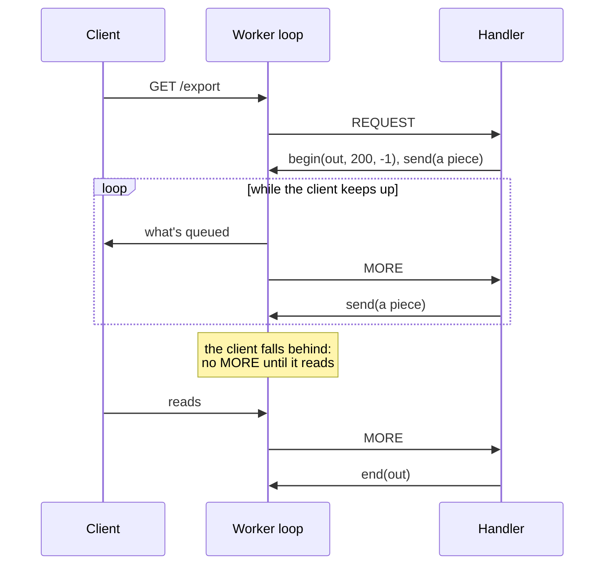
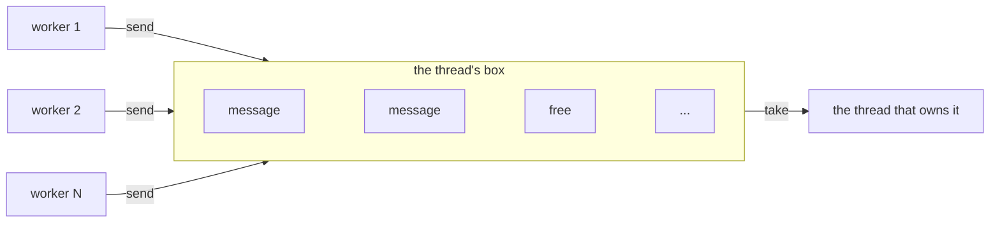
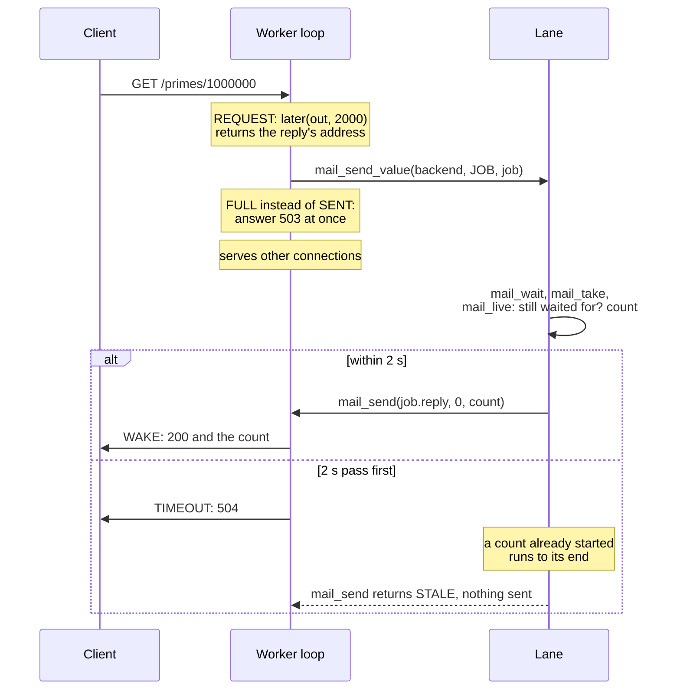

# Server patterns

This guide covers server patterns for large request bodies, long responses, slow work,
resource limits, crashes, and state that workers share. Each section presents a pattern, links
to an example, and points to the [API](api.md) for details. It builds on the README's
[concepts](../README.md#concepts). goose-rest's
[tutorial](https://github.com/kaitk/goose-rest/blob/main/docs/tutorial/README.md) builds
an application on these patterns, and each section names the page that does.

One fact explains each of these patterns: a worker is a single thread that runs the
handler for every connection it owns, thousands of them, one call at a time. Any time a
handler spends waiting holds up each of those connections, and memory a handler keeps
is multiplied by the connections doing the same. This is the thread-per-core,
shared-nothing model of [Seastar](https://seastar.io) and
[Tina](https://github.com/pmbanugo/tina), and its rule is the one Node.js states as
"don't block the event loop."

## Request bodies

Pick by how large a route's bodies get:

- **Up to 8 KB, with the head**: `body` already holds it, in the plain handler
  `{ req, body, out => }`. Most JSON requests fit. The limit is `Config.max_head`, the
  read buffer's size.
- **Larger, and needed whole**, as a large JSON document: wrap the handler in
  `http::gather` with a limit. It calls your code once, with the whole body. The worker
  holds each body it gathers in memory until your code returns, so set the limit to
  what it can hold for every connection gathering at once. Shown in
  [`upload/`'s `/words`](../examples/upload/upload.goose).

  ```rust
  struct Doc { body: http::Gather = http::Gather { .. } }

  let e = http::serve(cfg, Doc { .. }) { ev, st, out =>
      http::gather(ev, st.body, out, 4 << 20) { req, body, o =>
          // body is the whole request body, up to 4 MB.
          http::respond(o, 200, "text/plain", "ok");
      };
  };
  ```

- **Any size, read as it arrives**, as a file upload or a CSV import: use a handler
  with state, `{ ev, st, out => }`. It's called with each piece of the body as it
  arrives, so memory stays the same however large the body is. A body that fits the
  read buffer comes whole at `REQUEST`; a longer one starts there, goes on in `BODY`
  pieces, and ends at `END`. Shown in
  [`upload/`'s `/upload` and `/form`](../examples/upload/upload.goose).

  ```rust
  struct Upload { bytes: i64 = 0 }

  let e = http::serve(cfg, Upload { .. }) { ev, st, out =>
      if ev.kind == http::REQUEST || ev.kind == http::BODY {
          st.bytes += ev.data.len;   // a piece: write it to a file, or parse its lines
      }
      if (ev.kind == http::REQUEST && ev.whole) || ev.kind == http::END {
          var text: u8[..24] = [];
          format(text, st.bytes, " bytes\n");
          http::respond(out, 200, "text/plain", text);
      }
  };
  ```

A body over 1 MB gets 413 on every route until you raise `Config.max_body`, the
server's limit, as the first snippet needs for its 4 MB. `http::gather`'s limit and `http::body_within` set lower ones per route.

In the plain handler, a body over 8 KB isn't an error: `body` is empty, and the rest of
it is dropped. A route that can get one needs one of the other two.

With goose-rest: [JSON bodies](https://github.com/kaitk/goose-rest/blob/main/docs/tutorial/04-json.md)
and [large bodies](https://github.com/kaitk/goose-rest/blob/main/docs/tutorial/10-large-bodies.md).

## Long responses

A response the handler builds whole can be any size: the worker holds it until it's
sent. A response too large to hold, or made over time, goes in pieces instead:

- **Files**: `http::serve_file`, then `http::send_file` until it's done. Files of 64 KB
  or more go from the disk to the socket without passing through the program. Shown in
  `files/`.
- **Generated data**, such as an export: `http::begin` the response, and `http::send`
  a piece each time the loop calls with `MORE`. Shown in `compress/`.
- **Events over time**, such as Server-Sent Events: send a piece, then wait for the
  next with `http::later`, as in [slow work](#slow-work). Shown in `device/`.

The loop calls with `MORE` only while the client takes what it's sent, so a slow client
can't make the worker hold a whole response:



With goose-rest: a reply that a lane sends in pieces,
[two lanes, or a reply in pieces](https://github.com/kaitk/goose-rest/blob/main/docs/tutorial/12-two-lanes.md).

## Mail between threads

Threads share no memory, so they send each other messages. A thread that takes messages
owns a box: a fixed number of slots, each of a fixed size, set when the box opens. Any
thread sends to a box's address, and the send never blocks or grows the box. Here every
worker sends to one thread's box, two of whose slots hold messages:



Opening a box, sending to it, and taking from it need no other thread, so a test can do
all three on its own thread.

A send says at once whether the message went in, `SENT`, or why not:

- `FULL`: every slot is taken. The sender decides what the client gets, such as 503.
- `TOO_LONG`: the message is longer than a slot. Send it in pieces, or open the box
  with larger slots.
- `STALE`: nobody waits at that address any more, so the work can be dropped.

A worker waits for mail with `http::later`, which takes a time limit and returns the
address to reply to. How to shape that thread as a lane, and the work it takes:
[slow work](#slow-work). With goose-rest, a route asks a lane with
`rest::ask`, and the lane answers it:
[work that waits](https://github.com/kaitk/goose-rest/blob/main/docs/tutorial/11-waiting.md)
and [two lanes](https://github.com/kaitk/goose-rest/blob/main/docs/tutorial/12-two-lanes.md).

The design is [Tina](https://github.com/pmbanugo/tina)'s, a thread-per-core framework in
Odin: boxes bounded when they open, work sent to a thread's address rather than to a
shared queue, and a time limit on every wait. Its author explains the reasons in
[a post on async/await](https://pmbanugo.me/blog/why-async-await-complect-concurrency).
How the boxes work: [architecture](architecture.md#mail-between-threads).

## Slow work

A handler runs to its end on the worker, and the worker's other connections wait until it
does. Two kinds of work therefore leave the handler for a lane, a thread of its own that
does one kind of slow work. The handler mails the lane a job, and waits for the reply
without blocking the worker:

- **I/O-bound work**, such as a query to a database server, moves to a lane however short
  it is. In the handler, the core sits idle during the wait: a 20 ms query limits a
  worker to 50 such requests a second.
- **Long CPU-bound work** moves to a lane when it holds up the worker's other requests.
  Moving it adds no throughput when the workers use every core, but short requests stop
  waiting behind it, which keeps the tail latency down. How long is too long depends on
  the load and the required latency, because the tail grows with the spread of service
  times ([background](architecture.md#background)).

Short CPU-bound work, including a query on embedded SQLite, stays in the handler:

| The work | Where it runs | Shown in |
|---|---|---|
| Short and CPU-bound: parse, look up, format, query embedded SQLite | In the handler | `routes/`, `api/` |
| I/O-bound, or long and CPU-bound | A lane; the handler waits with `http::later` | `later/`, which counts primes |
| Either, going on with results as they come | The same, with the response sent in pieces | `device/`'s `/api/events` |
| Minutes of either | A background task: answer `202 Accepted` with its ID at once, and let the client ask for the result | goose-rest's [background tasks](https://github.com/kaitk/goose-rest/blob/main/docs/tutorial/13-limits.md#background-tasks) |

The split is the half-sync/half-async pattern: workers are the asynchronous half, the
lanes are the synchronous half and run plain blocking code, and mail is the queue
between them. In the classic pattern a pool of threads drains one shared queue. Here
each job goes to one thread's own bounded box, as in the actor model and
[Tina](#mail-between-threads).

Where any of a pool of threads may take any job, and their order doesn't matter, the
jobs can go through Goose's own queue of their type instead, bounded as a box is: the
program sets `qlimit<Job>(n)` once, a handler answers 503 when `qput(job)` returns
false, and each thread of the pool waits with `qget<Job>(ms)`. The reply still goes by
mail, to the one worker that waits. `server/backend.goose` takes its jobs that way
([why](decisions.md#waiting-through-bounded-boxes-in-c)).

The handler sends the job by mail and sets a time limit. The worker serves its other
connections until the reply arrives or the time limit expires:



- **A job can't be stopped from outside.** Once it starts, it runs to its end, past its
  time limit if need be. Check `http::mail_live(reply)` before starting, as `later/`
  does, and between the steps of a long job.
- **One thread runs its jobs one at a time.** A job queued behind a long one can time
  out before it starts. For more at once, start several threads, each with its own box,
  and send each job to one of them.
- **A wait isn't free.** It holds the connection, a timer, and any requests pipelined
  behind it, and a worker waits for at most `Config.max_waiting` at once. Work that
  takes minutes is better as a background task, which the client asks about after a
  `202 Accepted`.

A lane stops when `main` stops its box, once the workers have returned. The stop is a
flag in the box, not a message, so a full box can't refuse it. The lane takes every
job queued before the stop, then `http::mail_stopped` ends its loop, and `main`'s
`thread_wait` returns. As `later/` does:

```rust
thread_fn backend(box: http::Box) {
    while !http::mail_stopped(box) {
        http::mail_wait(box, -1);   // a stop wakes it too
        http::mail_take(box) { key, tag, bytes => /* the job */ };
    }
    http::mail_close(box);
}

fn main() {
    // ...
    http::run(cfg, http::address(b, 0), worker);   // returns once the workers have
    http::mail_stop(b);
    thread_wait(lane);
}
```

Replies to jobs that finish after the workers have stopped return `STALE`. Which cores
a lane runs on, beside the workers, and at what priority, a placement file can set:
[tuning](tuning.md).

Waiting is off until `Config.mail_slots` and `Config.max_waiting` are set. The calls,
and every limit: [API, answers that wait](api.md#answers-that-wait). With goose-rest:
[work that waits](https://github.com/kaitk/goose-rest/blob/main/docs/tutorial/11-waiting.md).

## Limits

Every resource a worker holds is bounded by a `Config` field, and past each bound the
loop answers or closes rather than grow:

| Bound | Field, default | Past it |
|---|---|---|
| A request head | `max_head`, 8 KB; `max_line`, `max_fields` | 414 for a long request line, 431 for too many fields |
| A body | `max_body`, 1 MB | 413 |
| Time for a head to arrive, and between a body's pieces | `request_ms`, `body_ms`, 10 s each | 408, or the connection closes |
| A client that stops taking its response | `write_ms`, 10 s | the connection closes |
| Responses queued and not yet sent | `max_queued`, 64 KB | the loop stops reading from the connection until the client takes them |
| Connections | `max_conns`, 16,384 per worker | new ones are refused |
| Routes waiting at once | `max_waiting` | `later`'s exchange gets `TIMEOUT` at once |
| Jobs waiting for a thread | the slots its box opened with | `FULL`: the handler answers, such as 503 |

A slow client is the loop's to bound: `max_queued` and `MORE` keep a response it reads
slowly from growing in the worker ([long responses](#long-responses)), and `write_ms`
closes one that stops reading. A wait is the handler's: it gives each `later` a time
limit, answers 503 when a box is `FULL`, and has its thread check `http::mail_live`
before work nobody waits for ([slow work](#slow-work)).

For goose-rest's answers at each limit and a background task the client polls, see
[limits](https://github.com/kaitk/goose-rest/blob/main/docs/tutorial/13-limits.md).

## Crashes

An abort in a worker, such as an index out of bounds in a handler, ends only that
worker when `http::run` started it: `run` prints the abort, starts the worker again,
and the others serve on meanwhile
([why](decisions.md#httprun-restarts-a-worker-that-aborts)). The request that aborted,
and the others on that worker's connections, get no answer; their clients wait until
they give up. A handler should still answer an error rather than abort where it can.

An abort ends the whole process when it is in a worker the program spawned itself, or in
a lane that doesn't opt into restarts (goose-rest's `rest::keep`), and when a worker has
aborted `Config.restarts` times in a row. Run the server
under a service manager that restarts it, after a delay, and gives up after a few
crashes in a row, so a crash that repeats at startup doesn't loop:

| Manager | Restart | Against a crash loop |
|---|---|---|
| systemd | `Restart=on-failure`, `RestartSec=1` | `StartLimitIntervalSec=60`, `StartLimitBurst=5` in `[Unit]` |
| Docker Compose | `restart: on-failure:5` | the count after `on-failure`; Docker doubles the delay between restarts |
| Kubernetes | a Deployment's pods restart by default | `CrashLoopBackOff` delays each restart, up to 5 minutes |

`SIGTERM` stops the server gracefully under each of them (`http::stop_on_signals`,
[running a server](api.md#running-a-server)). [Embedded Linux](embedded.md) has a whole
systemd unit.

## State that workers share

Each worker has its own copy of the program's globals, made when it starts, and workers
share no memory. In `api/`, a note written through one worker isn't there for another.

The copies cost more than one per worker. `thread_spawn` copies each global a worker
uses, the worker keeps both the copy it was sent and its own, and the thread that spawned
it keeps the original. Data that `main` loads into a global before it starts four workers
is then held about ten times
([findings](goose-findings.md#a-worker-holds-its-globals-twice-and-its-spawner-keeps-a-third-copy)).

- **Data built at startup and only read**, such as a catalog: the store,
  `http.store` (`import http.store`), keeps one copy that every worker reads
  ([architecture](architecture.md#the-store)). The benchmarks' REST
  server, `bench/rest/goose/rest.goose`, uses it.
- **Data that changes**, such as counters or sessions: give it one owner thread, and
  have workers ask it by [mail](#mail-between-threads).

With goose-rest: [state](https://github.com/kaitk/goose-rest/blob/main/docs/tutorial/08-state.md).
